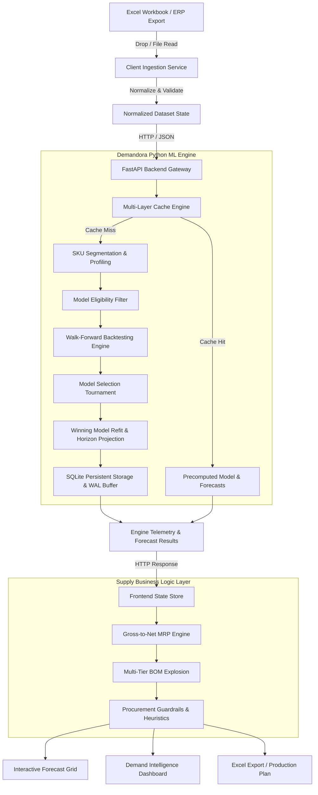

# DEMANDORA
### AI-Powered Demand & Supply Intelligence Platform

<p align="center">
  
</p>

<p align="center">
  <strong>See Demand. Predict Change. Plan Smarter.</strong><br>
  <em>Enterprise-grade, automated time-series forecasting, demand lifecycle segmentation, multi-layer caching, and gross-to-net Material Requirements Planning (MRP).</em>
</p>

<p align="center">
  
  
  
  
  
  
  
  
</p>

---

## 1. Product Introduction

**Demandora** is an enterprise-grade demand forecasting and supply chain intelligence platform designed for manufacturing, assembly, and multi-echelon distribution organizations. It bridges the gap between raw transaction data (sales orders, stock balances, open purchase orders, bills of materials) and actionable procurement schedules.

Unlike monolithic legacy ERP tools or simplistic moving-average spreadsheets, Demandora incorporates a **multi-model statistical tournament** with **chronological walk-forward backtesting**, automated **demand segmentation (Runner, Repeater, Stranger)**, and **deterministic procurement heuristics**.

---

## 2. Product Purpose & Problems Solved

Supply chain and inventory planners routinely face critical operational challenges:
- **Excess Working Capital vs. Stockouts**: Over-ordering slow-moving goods while facing stockouts on high-velocity items due to uncalibrated safety stock rules.
- **Intermittent & Lumpy Demand**: Standard time-series models fail dramatically on intermittent or sporadic demand streams.
- **Lack of Model Accountability**: Planners rarely know *which* model produced a forecast, why it was chosen, or how it performed historically.
- **Data Ingestion Friction**: Enterprise teams manage data across disparate Excel workbooks, messy ERP exports, and siloed spreadsheets.
- **Computational Latency**: Backtesting thousands of SKUs across multiple candidate models can freeze planning operations for hours.

**Demandora solves these problems by providing:**
1. **Automated SKU Profiling & Classification**: Segmenting portfolios into demand regimes (Runner, Repeater, Stranger) using Coefficient of Variation ($CV^2$) and Average Demand Interval ($ADI$).
2. **Strict Chronological Backtesting**: Testing candidate models across 12 expanding validation folds with **zero temporal data leakage**.
3. **5-Layer Persistent SQLite Cache**: Sub-second response times on warm portfolios through content-addressable SHA-256 data fingerprinting and WAL-mode SQLite caching.
4. **Deterministic Gross-to-Net MRP**: Automatic netting against stock, open purchase orders, and sales orders, respecting MOQ, order multiples, and lead-time offset.
5. **Multi-Level BOM Explosion**: Component-level netting and dependency planning for complex assemblies.

---

## 3. Key Capabilities

- **Automated Statistical Tournament**: Evaluates 9 candidate models per mature SKU:
  - Naive & Seasonal Naive
  - Historical Mean & Moving Averages
  - Exponential Smoothing (Holt's Linear / Additive)
  - Croston's Method & Syntetos-Boylan Approximation (SBA) for intermittent demand
  - Histogram-Based Gradient Boosting Regressors (`HistGradientBoostingRegressor`) with lag and rolling features
- **Mathematical Evaluation Rigor**:
  - Out-of-sample metrics: **WAPE** (Weighted Absolute Percentage Error), **MAE**, **RMSE**, and **Normalized Mean Bias**.
  - Tie-breaking hierarchy prioritizing lowest WAPE, followed by MAE, RMSE, and minimal bias.
- **Procurement Decision Guardrails**:
  - Automatically identifies forecast over-optimism or chronic under-forecasting.
  - Applies safety-stock multipliers and buffer caps tailored to SKU lifecycle velocity.
- **Universal Excel Ingestion**:
  - Intelligent column alias fuzzy matching for messy ERP exports.
  - Ingests Item Master, Sales History, Inventory, Open POs, Open SOs, and BOM sheets simultaneously.
- **High-Density Forecast Grid**:
  - Horizontally scrollable, freeze-column layout displaying SKU metadata, demand profile, model selection, forecast horizon, and procurement recommendations.
  - Interactive manual override mechanism with full planner audit tracking.

---

## 4. System Architecture

Demandora operates on a decoupled client-server architecture combining a responsive React/TypeScript frontend with an authoritative Python machine learning backend.



---

## 5. Technology Stack

| Layer | Technologies |
|---|---|
| **Frontend Framework** | React 18.3.1, TypeScript 5.5.3, Vite 5.4.2 |
| **Icons & UI** | Lucide React, Custom SVG Design System, Glassmorphic Dashboard CSS |
| **Data Parsing & Export** | SheetJS (XLSX 0.18.5) with full multi-sheet styling |
| **Client Test Runner** | Vitest 4.0.18 with jsdom environment (201 test suites) |
| **Backend Framework** | FastAPI 0.111.0, Uvicorn ASGI Server |
| **Machine Learning & Stats** | scikit-learn 1.5.0+, statsmodels 0.14.0+, NumPy 2.x, Pandas 2.x |
| **Caching & Persistence** | SQLite 3 (WAL mode, memory-mapped I/O, synchronous=NORMAL) |
| **Backend Test Runner** | Pytest 8.2.0+ (190 test suites) |

---

## 6. Project Directory Structure

```
demandora/
├── backend/
│   ├── cache_data/            # Persistent SQLite database storage (excluded from git)
│   ├── tests/                 # 190 pytest test cases (backtest, cache, segmentation, models)
│   ├── backtesting.py         # Chronological expanding-window validation engine
│   ├── cache.py               # 5-layer SQLite caching & fingerprinting subsystem
│   ├── cold_start.py          # Category & attribute-based cold-start algorithms
│   ├── engine.py              # Central forecasting pipeline orchestrator
│   ├── heuristics.py          # Procurement safety stock guardrails & bias dampening
│   ├── llm.py                 # Optional LLM demand commentary generator
│   ├── main.py                # FastAPI HTTP server & endpoint definitions
│   ├── model_selection.py     # Deterministic tournament selection logic
│   ├── models.py              # 9 candidate statistical and ML models
│   ├── requirements.txt       # Python dependencies
│   └── segmentation.py        # Runner / Repeater / Stranger classification
├── public/
│   ├── demandora-logo.svg     # Official Demandora wordmark and emblem
│   └── favicon.svg            # Modern SVG browser favicon
├── src/
│   ├── components/            # React UI components (ForecastGrid, Dashboard, BOM, MRP)
│   ├── services/              # Client services (excelService, mrpService, persistence)
│   ├── App.tsx                # Primary application shell & navigation
│   ├── index.html             # Application entrypoint & metadata
│   ├── main.tsx               # React DOM bootstrap
│   ├── styles.css             # Unified enterprise design system & CSS variables
│   └── types.ts               # Complete TypeScript domain contracts
├── docs/                      # Architectural specifications & audit logs
├── .env.example               # Template environment configuration
├── .gitignore                 # Exclusion rules for caches, venvs, and private databases
├── CONTRIBUTING.md            # Guidelines for open contributions and development
├── package.json               # Frontend dependencies & npm scripts
├── tsconfig.json              # Strict TypeScript compiler options
└── vite.config.ts             # Vite build & Vitest configuration
```

---

## 7. Installation & Setup

### Prerequisites
- **Node.js**: v18.0.0 or higher
- **Python**: v3.10 to v3.12

### Step 1: Clone the Repository
```bash
git clone https://github.com/your-username/demandora.git
cd demandora
```

### Step 2: Backend Setup
```bash
# Create and activate Python virtual environment
python -m venv .venv

# Windows (PowerShell):
.venv\Scripts\Activate.ps1
# Linux / macOS:
source .venv/bin/activate

# Install required Python packages
pip install -r backend/requirements.txt
```

### Step 3: Frontend Setup
```bash
# Install Node dependencies
npm install
```

### Step 4: Environment Configuration
```bash
# Copy example environment configuration
cp .env.example .env
```

---

## 8. Launching the Application

Start both the backend engine and the frontend development server:

### Terminal 1: Backend API Service
```bash
# Ensure virtual environment is active
python -m uvicorn backend.main:app --host 127.0.0.1 --port 8000 --reload
```
*The FastAPI documentation is available at `http://127.0.0.1:8000/docs`.*

### Terminal 2: Frontend Client
```bash
npm run dev
```
*The application interface is available at `http://localhost:3000`.*

---

## 9. Operating Workflow

### 1. Ingesting Data
- Navigate to the **Import Data** section or use the **Import Excel** modal.
- Upload an Excel workbook containing:
  - **Item Master**: SKU codes, descriptions, UoM, Make/Buy, lead time, MOQ, order multiples.
  - **Sales History**: Monthly historical unit sales per SKU.
  - **Inventory**: Current on-hand balances.
  - **Open POs & SOs**: Confirmed incoming and committed outgoing stock.
  - **BOM (Optional)**: Assembly parent-child relationships and component ratios.
- Demandora validates data types, flags missing mandatory fields, and displays an ingestion summary.

### 2. Generating Forecasts
- Specify your **Planning Horizon** (default: 6 months).
- Click **Generate Forecast**.
- Demandora passes normalized SKU time-series to the Python engine:
  - Profiling & segmentation.
  - Walk-forward candidate model backtesting.
  - Model selection tournament.
  - Final projection calculation.
- Results stream back with full telemetry (winning model, historical WAPE, compute time per SKU).

### 3. Reviewing & Adjusting
- In the **Forecast Grid**, inspect model choices, backtest error curves, and suggested procurement schedules.
- Apply manual adjustments if domain knowledge requires planner overrides.
- Export approved demand plans directly to multi-tab formatted Excel workbooks.

---

## 10. Caching & Performance Architecture

Demandora features a **5-layer persistent caching architecture** backed by SQLite in Write-Ahead Logging (WAL) mode:

1. **Layer 1: SKU Demand Profile Cache**: Memoizes life-cycle calculations (ADI, CV², total quantity, zero intervals).
2. **Layer 2: SKU Feature Set Cache**: Precomputes rolling statistics, Fourier cyclical features, and lag vectors.
3. **Layer 3: Walk-Forward Backtesting Evaluation Cache**: Caches validation window errors per model family.
4. **Layer 4: SKU Winning Model Cache**: Retains the winning algorithm and parameter states.
5. **Layer 5: End-to-End Horizon Forecast Cache**: Stores projected values keyed by SKU, horizon, and parameters.

### Benchmark Performance Evidence
- **Cold Benchmark (1,070 mature SKUs, 9 candidate models, 12 validation folds)**: Full computation completes in ~23.5 minutes on 8-core CPU.
- **Warm Re-Evaluation**: Sub-second execution (< 1.5 seconds) through persistent SQLite lookups.
- **Selective Delta Invalidation**: Changes to supply parameters (PO/SO/Stock) trigger instantaneous MRP updates without invalidating statistical demand models.

---

## 11. Testing & Verification

Demandora maintains a rigorous automated testing discipline across both stacks:

```bash
# Run backend test suite (190 tests)
pytest backend/tests -v

# Run frontend test suite (201 tests across 19 files)
npm test

# Verify TypeScript static types
npx tsc --noEmit

# Validate production build bundle
npm run build
```

---

## 12. Roadmap

- [x] Walk-forward backtesting tournament & model selection.
- [x] 5-layer persistent SQLite cache with zero-leakage validation.
- [x] Multi-tier Bill of Materials (BOM) explosion.
- [x] Gross-to-Net MRP calculation engine.
- [x] Enterprise rebranding to Demandora.
- [ ] Direct database connectors (PostgreSQL, Snowflake, BigQuery).
- [ ] Multi-scenario "What-If" planning simulation mode.
- [ ] Automated supplier lead-time variance tracking.

---

## 13. License

Proprietary and Confidential. All rights reserved.
Developed for enterprise demand and supply intelligence operations.
