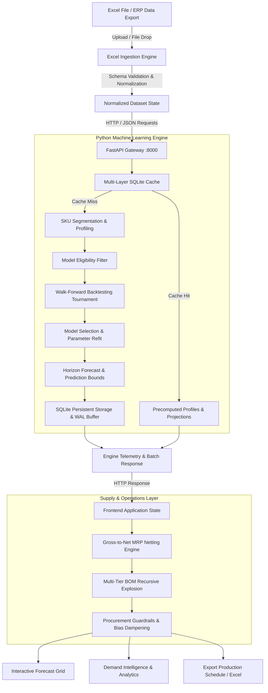

# DEMANDORA
### AI-Powered Demand & Supply Intelligence Platform

<p align="center">
  
</p>

<p align="center">
  <strong>See Demand. Predict Change. Plan Smarter.</strong><br>
  <em>Enterprise-grade, automated time-series forecasting, demand lifecycle segmentation, multi-layer caching, and gross-to-net Material Requirements Planning (MRP).</em>
</p>

<p align="center">
  
  
  
  
  
  
  
  
</p>

---

## 1. Product Introduction

**Demandora** is an enterprise-grade demand forecasting and supply chain intelligence platform designed for manufacturing, assembly, and multi-echelon distribution organizations. It bridges the gap between raw transaction data (sales orders, stock balances, open purchase orders, bills of materials) and actionable procurement schedules.

Unlike monolithic legacy ERP tools or simplistic moving-average spreadsheets, Demandora incorporates a **multi-model statistical tournament** with **chronological walk-forward backtesting**, automated **demand segmentation (Runner, Repeater, Stranger)**, and **deterministic procurement heuristics**.

---

## 2. Key Capabilities

- **Automated Statistical Tournament**: Evaluates up to 9 candidate models per mature SKU:
  - Naive & Seasonal Naive
  - Historical Mean & Moving Averages (SMA-3, WMA-3)
  - Linear Trend Regression (OLS)
  - Exponential Smoothing (Holt's Linear / Additive via `statsmodels`)
  - Croston's Method & Syntetos-Boylan Approximation (SBA) for intermittent demand
  - Histogram-Based Gradient Boosting Regressors (`HistGradientBoostingRegressor`) with lag and rolling features
- **Mathematical Evaluation Rigor**:
  - Out-of-sample metrics: **WAPE** (Weighted Absolute Percentage Error), **MAE**, **RMSE**, and **Normalized Mean Bias**.
  - Strict tie-breaking hierarchy: lowest WAPE, followed by MAE, RMSE, and minimal absolute bias.
  - Zero temporal data leakage: strictly chronological expanding validation folds.
- **Demand Lifecycle Profiling**:
  - Portfolio classification into Runner, Repeater, and Stranger regimes using Coefficient of Variation ($CV^2$) and Average Demand Interval ($ADI$).
- **Procurement Decision Guardrails**:
  - Identifies model bias and dampens safety stock recommendations to avoid bullwhip effect inventory build-up.
- **Universal Excel Ingestion**:
  - Ingests Item Master, Sales History, Inventory, Open POs, Open SOs, and BOM sheets with column alias fuzzy matching.
- **Deterministic Gross-to-Net MRP**:
  - Automatic netting against stock, open purchase orders, and sales orders, respecting MOQ, order multiples, and lead-time offset.
- **Multi-Level BOM Explosion**:
  - Recursive component-level netting and shortage detection for manufactured assemblies.
- **High-Density Forecast Grid**:
  - Horizontally scrollable, freeze-column layout displaying SKU metadata, demand profile, model selection, forecast horizon, and procurement recommendations with full planner audit tracking.

---

## 3. System Architecture

Demandora operates on a decoupled client-server architecture combining a responsive React/TypeScript frontend with an authoritative Python machine learning backend.



*For comprehensive architectural specifications, see [docs/architecture.md](docs/architecture.md).*

---

## 4. Technology Stack

| Layer | Technologies & Libraries |
|---|---|
| **Frontend Framework** | React 19.0.0, TypeScript 5.7.2, Vite 6.0.7 |
| **UI & Visual Design** | Lucide React 1.16.0, Custom SVG Design System, Glassmorphic CSS |
| **Data Parsing & Export** | SheetJS (XLSX 0.18.5) with multi-tab formatted export |
| **Client Test Runner** | Vitest 5.0.3 (201 automated test suites) |
| **Backend Framework** | FastAPI 0.115+, Uvicorn 0.30+ ASGI Server |
| **Machine Learning & Stats** | scikit-learn 1.5+, statsmodels 0.14+, NumPy 2.x, Pandas 2.x |
| **Caching & Persistence** | SQLite 3 (WAL mode, memory-mapped I/O, synchronous=NORMAL) |
| **Backend Test Runner** | Pytest 8.x (190 automated test suites) |

---

## 5. Project Directory Structure

```
Demandora/
├── backend/
│   ├── cache_data/            # Persistent SQLite database storage (excluded from git)
│   ├── tests/                 # 190 pytest test cases (backtest, cache, segmentation, models)
│   ├── backtesting.py         # Chronological expanding-window validation engine
│   ├── cache.py               # 5-layer SQLite caching & fingerprinting subsystem
│   ├── cold_start.py          # Category & attribute-based cold-start algorithms
│   ├── engine.py              # Central forecasting pipeline orchestrator
│   ├── heuristics.py          # Procurement safety stock guardrails & bias dampening
│   ├── llm.py                 # Optional LLM demand commentary generator
│   ├── main.py                # FastAPI HTTP server & endpoint definitions
│   ├── model_selection.py     # Deterministic tournament selection logic
│   ├── models.py              # 9 candidate statistical and ML models
│   ├── requirements.txt       # Python dependencies (FastAPI, scikit-learn, statsmodels)
│   └── segmentation.py        # Runner / Repeater / Stranger classification
├── docs/                      # Professional technical documentation
│   ├── architecture.md        # Detailed system architecture & data flow
│   ├── benchmarks.md          # Empirical benchmark methodology & telemetry records
│   ├── caching-system.md      # 5-layer SQLite caching & invalidation design
│   ├── development-guide.md   # Local setup, development, and testing guide
│   ├── forecasting-engine.md  # Model mathematics, backtesting, and segmentation rules
│   └── inventory-and-mrp.md   # Gross-to-net MRP, MOQ offsets, and BOM explosion
├── public/
│   ├── demandora-logo.svg     # Official Demandora wordmark and emblem
│   └── favicon.svg            # Modern SVG browser favicon
├── src/
│   ├── components/            # React UI components (ForecastGrid, Dashboard, BOM, MRP)
│   ├── services/              # Client services (excelService, mrpService, persistence)
│   ├── App.tsx                # Primary application shell & navigation
│   ├── index.html             # Application entrypoint & metadata
│   ├── main.tsx               # React DOM bootstrap
│   ├── styles.css             # Unified enterprise design system & CSS variables
│   └── types.ts               # Complete TypeScript domain contracts
├── .env.example               # Template environment configuration
├── .gitignore                 # Exclusion rules for caches, venvs, and private databases
├── CONTRIBUTING.md            # Guidelines for open contributions and development
├── package.json               # Frontend dependencies & npm scripts
├── tsconfig.json              # Strict TypeScript compiler options
├── start.bat                  # One-click Windows launch script
├── stop.bat                   # One-click Windows stop script
└── vite.config.ts             # Vite build & Vitest configuration
```

---

## 6. Installation & Setup

### Prerequisites
- **Node.js**: v18.0.0 or higher (v20.x recommended)
- **Python**: v3.10 to v3.12 (Python 3.12 recommended)

### Step 1: Clone Repository
```bash
git clone https://github.com/scody1/Demandora.git
cd Demandora
```

### Step 2: Backend Virtual Environment & Dependencies
```bash
python -m venv .venv

# Windows (PowerShell):
.venv\Scripts\Activate.ps1
# Linux / macOS:
source .venv/bin/activate

# Install backend dependencies
pip install -r backend/requirements.txt
```

### Step 3: Frontend Dependencies
```bash
npm install
```

### Step 4: Environment Configuration
```bash
cp .env.example .env
```

---

## 7. Launching the Application

### One-Click Launch (Windows)
Run `start.bat` in the project root to start both backend and frontend servers and open your browser automatically.

### Manual Launch

**Terminal 1 (Backend ML Service):**
```bash
.venv\Scripts\python.exe -m uvicorn backend.main:app --host 127.0.0.1 --port 8000 --reload
```
*API documentation is available at `http://127.0.0.1:8000/docs`.*

**Terminal 2 (Frontend Client):**
```bash
npm run dev
```
*Application interface is available at `http://localhost:3000`.*

---

## 8. Caching & Performance Architecture

Demandora features a **5-layer persistent caching architecture** backed by SQLite in Write-Ahead Logging (WAL) mode:

1. **Layer 1: SKU Demand Profile Cache**: Memoizes lifecycle statistics ($ADI$, $CV^2$, seasonality, trend).
2. **Layer 2: SKU Feature Set Cache**: Precomputes rolling statistics, cyclical features, and lag vectors.
3. **Layer 3: Walk-Forward Backtesting Cache**: Caches validation window errors and tournament rankings.
4. **Layer 4: Winning Model Artifact Cache**: Retains winning algorithm parameters and refit state.
5. **Layer 5: End-to-End Forecast Cache**: Stores projected values keyed by SKU, horizon, and parameters.

### Empirical Performance Evidence (2,094 SKUs, 24 Monthly Periods)
- **Cold Portfolio (Initial Ingestion)**: ~23.5 minutes (1,409.95 s) evaluating 9,630 model candidates across 129,659 validation windows on an 8-core CPU.
- **Warm Re-Evaluation (Identical Portfolio)**: ~2.06 minutes (123.72 s), avoiding 40,330 redundant model fits and 515,436 validation window evaluations (99.66% cache hit ratio).
- **Supply-Only / MRP Delta Updates**: Instantaneous (< 1.5 seconds) gross-to-net MRP recalculation without refitting machine-learning demand models.

*For detailed execution logs and methodology, see [docs/benchmarks.md](docs/benchmarks.md).*

---

## 9. Testing & Quality Assurance

Demandora maintains automated test suites across both stacks:

```bash
# Run backend test suite (190 tests)
pytest backend/tests -v

# Run frontend test suite (201 tests across 19 files)
npm test

# Verify TypeScript static types (0 errors)
npx tsc --noEmit

# Validate production build
npm run build
```

---

## 10. Technical Documentation Index

Detailed specifications are available in the [`docs/`](docs/) directory:
- [System Architecture](docs/architecture.md): Data pipeline, client-server communication, component breakdown.
- [Forecasting Engine](docs/forecasting-engine.md): 9 candidate models, walk-forward cross-validation, tie-breaking logic.
- [Caching System](docs/caching-system.md): 5-layer content-addressable cache, WAL mode, selective invalidation.
- [Inventory & MRP](docs/inventory-and-mrp.md): Gross-to-net netting, MOQ order sizing, lead-time offsets, multi-tier BOM explosion.
- [Benchmark Report](docs/benchmarks.md): Measured cold vs. warm timings, cache hit rates, hardware specifications.
- [Development Guide](docs/development-guide.md): Local installation, testing instructions, contribution workflow.

---

## 11. Limitations & Roadmap

- **Current Capabilities**: Automated walk-forward tournament selection, 5-layer persistent caching, multi-tier BOM explosion, gross-to-net MRP, and interactive manual override tracking.
- **Roadmap**:
  - Direct database connectors (PostgreSQL, Snowflake, BigQuery) alongside Excel ingestion.
  - Multi-scenario "What-If" planning simulation mode.
  - Automated supplier lead-time variance tracking.

---

## 12. License

Proprietary and Confidential. All rights reserved.  
Developed for enterprise demand and supply intelligence operations.
