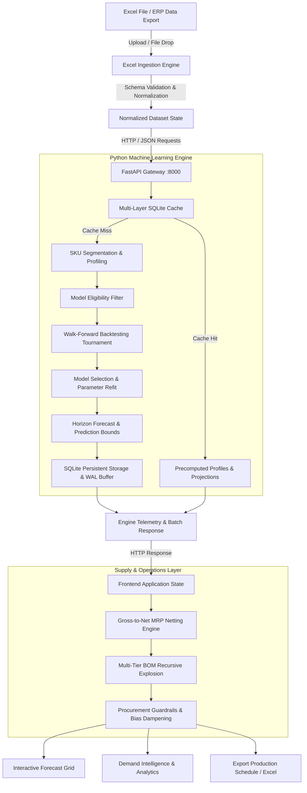

# Demandora System Architecture

Demandora is an enterprise-grade demand forecasting and supply intelligence platform designed with a decoupled client-server architecture. It combines a high-density, interactive React/TypeScript frontend with an authoritative Python machine-learning backend.

---

## 1. High-Level Architecture Overview

---

## 2. Component Breakdown

### Frontend Client (`src/`)
- **Technology**: React 19, TypeScript 5.7, Vite 6, Lucide React.
- **Role**: User interface, workbook ingestion, client-side data validation, interactive adjustments, and instant supply-side recalculations.
- **Key Modules**:
  - `src/components/ForecastGrid.tsx`: Virtualized, horizontally scrollable data grid with sticky columns, heuristic popovers, and planner overrides.
  - `src/components/DemandIntelligenceView.tsx`: Portfolio lifecycle analytics, 4-quadrant velocity matrix, and seasonality analysis.
  - `src/components/ComponentsView.tsx`: Bill of Materials (BOM) explosion, component shortage detection, and purchase requisition scheduling.
  - `src/services/excelService.ts`: Schema-tolerant Excel ingestion with alias fuzzy matching and multi-tab export.
  - `src/services/persistenceService.ts`: Local state persistence with backward-compatible session recovery.

### Backend ML Engine (`backend/`)
- **Technology**: FastAPI (>=0.115), Uvicorn, Python 3.12, scikit-learn (>=1.5), statsmodels (>=0.14), NumPy, Pandas.
- **Role**: Statistical modeling, demand classification, chronological backtesting tournament, parameter optimization, and multi-layer caching.
- **Key Modules**:
  - `backend/main.py`: REST API endpoints (`/health`, `/api/forecast/models`, `/api/forecast/predict`, `/api/forecast/batch`, `/api/forecast/jobs/{id}`).
  - `backend/engine.py`: Central forecasting pipeline orchestrator.
  - `backend/models.py`: 9 candidate model implementations (statistical, baseline, exponential smoothing, gradient boosting).
  - `backend/backtesting.py`: Chronological expanding-window cross-validation with zero temporal leakage.
  - `backend/cache.py`: 5-layer persistent SQLite cache with Write-Ahead Logging (WAL).
  - `backend/segmentation.py`: SKU demand classification into Runner, Repeater, Stranger, and Unclassified.
  - `backend/heuristics.py`: Procurement guardrails translating forecast bias into safety stock adjustments.

---

## 3. Communication Protocols

1. **Batch Forecast Dispatch**: The client sends a normalized JSON payload containing SKU time-series histories to `POST /api/forecast/batch`.
2. **Asynchronous Background Processing**: For large workloads, long-running batch jobs are dispatched asynchronously, returning a `job_id` polled via `GET /api/forecast/jobs/{job_id}`.
3. **Synchronous Single-SKU Query**: Fast single-SKU predictions and model inspections via `POST /api/forecast/predict`.
4. **Health & Telemetry**: Health checks via `GET /health` and model capability queries via `GET /api/forecast/models`.
